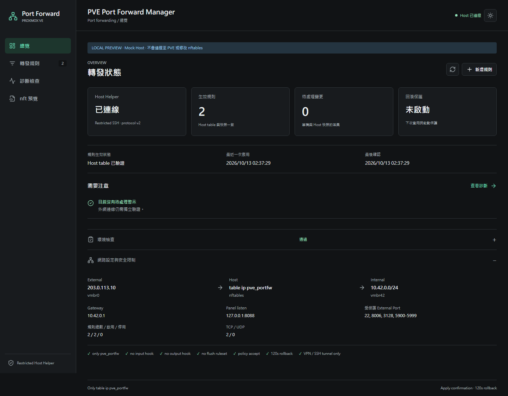
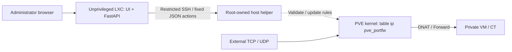

# PVE Port Forward Manager

A focused IPv4 port forwarding manager for Proxmox VE homelabs: review a draft, validate it on the host, apply it with a confirmation window, and restore the previous snapshot if needed.

**Beta candidate: `0.2.0-beta.1`.** Not a production-stable release. Host Helper protocol v2 is a protocol version, not a product stability claim. Upgrade the CT panel and host helper together.



## Features

- Rule editing, search, filters, duplication, JSON import/export and local backups.
- Separate draft, saved, applied, confirmed and rolled-back states.
- Host-verified active rules; saved JSON alone is never shown as evidence of forwarding.
- Dry Run, atomic Apply, exact-snapshot Confirm and a host-owned 120-second rollback deadline.
- Read-only preflight and scoped diagnostics, with untested connectivity shown as unknown.
- Bundled UI assets, responsive dark/light modes and opt-in host boot recovery.

## Architecture



Only management operations traverse FastAPI and SSH. Forwarded packets go through the host kernel, not the Web Panel. The helper independently validates rules and accepts neither arbitrary nft scripts nor shell commands or caller-selected paths.

## Installation and Upgrade

Follow [Installation](docs/INSTALLATION.md) for the unprivileged CT, restricted host helper, SSH host-key pinning, coordinated v1 upgrade and optional boot recovery.

Use Python 3.11+. Review your own bridge, gateway, address and firewall settings; the tool does not create networking. The supplied templates use `203.0.113.10`, `10.42.0.0/24` and `vmbr42` as synthetic examples. Existing local configs are preserved on upgrade. Runtime fallback values are retained for compatibility; do not rely on an unset environment matching the new templates.

Both installers avoid applying nft rules or starting host recovery. The CT installer starts only the panel service. Installation or Confirm does not enable boot recovery.

## Basic Workflow

For the example VM `10.42.0.100:22`, create a TCP rule from external port `2222` to internal port `22`:

1. Add the rule in **轉發規則**; it starts as an unsaved draft.
2. Open **檢視並套用** and review the changes.
3. Run **驗證 / Dry Run**. The UI saves the draft and checks prerequisites/syntax without changing nftables.
4. Select **儲存並套用**. Apply journals the baseline and starts the host rollback watchdog before replacing the project table in one nft batch.
5. Test new connections from an independent Internet connection.
6. Select **確認套用** within 120 seconds, or request **立即回滾** / leave it unconfirmed.

Confirm verifies the exact pending transaction and live table, not a draft edited afterward. On the first v2 Apply, rollback restores the previous actual project table, or removes only the new project table if none existed. Later transactions use the confirmed snapshot. Failed rollback retains pending state for investigation/retry; restoration is not guaranteed under host failures.

Save/Import only change the draft. Restoring a UI backup changes the saved draft only; changing live nft rules still requires reviewed Dry Run and Apply. Rollback preserves a different draft saved after Apply, and backs up the draft before any safe reconciliation. Export/Copy in the UI include unsaved edits; the direct API export returns saved rules. Disable All removes DNAT mappings only after Apply; it does not remove subnet masquerade or act as a network kill switch. Dry Run and CT-local TCP diagnostics do not prove Internet or UDP delivery.

## Security and Limits

Read [SECURITY.md](SECURITY.md) before installation.

- There is no login/RBAC. Keep the panel bound to CT loopback and use authenticated private access, such as an SSH tunnel. CSRF is not authorization.
- The helper owns only `table ip pve_portfw`. It does not flush the ruleset, manage other tables, create an input firewall or override another chain's drop.
- Protected **external** ports default to `22, 8006, 3128, 5900-5999`; guest SSH on internal port 22 is allowed.
- IPv4 TCP/UDP and single numeric ports only. IPv6 NAT, ranges, hairpin NAT, destination hostnames, DHCP/DNS, VM, bridge, route, VPN and full firewall management are outside scope.
- Run one Uvicorn worker; reload the browser after a panel restart. Existing conntrack sessions can retain old translations.
- Recovery is opt-in and restores only an absent project table from a host-owned confirmed snapshot. It refuses a different existing table and does not continuously fight firewall reloads. Revalidate snapshots after network/policy changes.
- Fresh installation, real systemd deadlines, PVE firewall ordering and end-to-end traffic require acceptance testing on a disposable environment. Automated mocks do not establish compatibility with every PVE release.
- Backups/audit need administrator-managed retention. Dependency ranges are not a fully locked reproducible build.

## Development and Verification

```bash
python -m venv .venv
. .venv/bin/activate
pip install -r requirements-dev.txt
python -m pytest -q
node --check app/static/app.js
node --check app/static/theme.js
python scripts/preview.py --port 8089
```

On Windows use `.venv\Scripts\python.exe`. The preview binds to `127.0.0.1:8089`, forces synthetic settings, uses a mock host and opens no SSH, nft or destination socket connections.

In another terminal:

```bash
python -m playwright install chromium
python tests/browser_workflow.py --url http://127.0.0.1:8089
# Optional Linux-only parser/kernel checks in a fresh user/network namespace:
python tests/nft_namespace.py
```

Browser tests require the loopback mock application and write screenshots under ignored `.artifacts/browser/`, never `docs/`. Namespace tests refuse the parent network namespace and a nonempty initial ruleset; systemd and interface readiness are mocked. See [Troubleshooting](docs/TROUBLESHOOTING.md#development-checks) for installer syntax checks and manual acceptance boundaries.

The API schema is available at `/openapi.json`. Mutations require the cookie and `X-CSRF-Token` from `/api/session`. Use the `/api/rules` ETag in `If-Match` for draft writes and the same revision in Dry Run/Apply. Protocol v2 requires matching settings at both ends; unknown active state is not zero rules.

## Contributing and Support

[Report a bug or propose a change](https://github.com/fishbaby1011/pve-portfw-manager/issues) with the version, CT/host role, failing step, redacted configuration and reproducible checks. Keep contributions within the port-forwarding scope. Changes to transaction behavior need failure, timeout, replay, concurrency and recovery coverage. Review UI changes at desktop/mobile sizes.

Never attach private keys, credentials, raw deployment logs or unreviewed screenshots. Report vulnerabilities privately as described in [SECURITY.md](SECURITY.md).

## License

[MIT](LICENSE). Bundled Lucide 0.468.0 retains its [license notice](app/static/vendor/LUCIDE-LICENSE).
